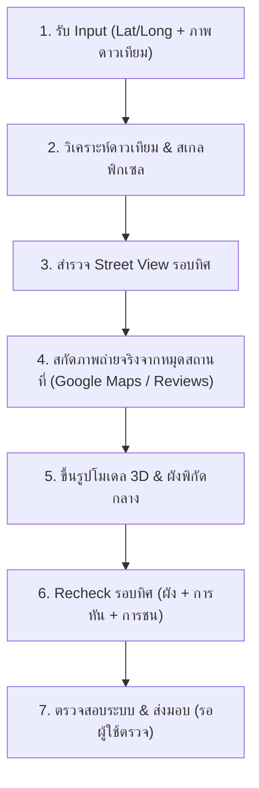

# EN KKU · Faculty Campus Explorer

Interactive Three.js exterior model of the Faculty of Engineering, Khon Kaen University. Seventeen current building codes are modeled, with geometric roads, pedestrian links, forecourts and planting. The current scene is a progressive architectural reconstruction; geometry and photographic coverage are labelled per building.

## Run

```powershell
npm run dev
```

Open http://localhost:8089/. No package installation is needed for the app. Three.js/OrbitControls are included locally in `vendor/`; the app has no dependency on the former reference checkout.

## Explore

- Search EN code, Thai/English name or CB. Select from the list, a model surface, floating tag, or the satellite minimap.
- View the entire faculty, overhead plan, or four sides of a selected building. EN16 also has entrance, public hall and bridge presets.
- Drag to orbit; wheel to zoom; right-drag to pan. Use the surrounding-building switch to isolate a selected building.
- Walk: WASD/arrows, drag to look, Shift to move faster, Esc to exit. Floor selection and internal room layouts are outside the current scope.
- Main terrain is entirely modeled. Satellite imagery appears only in the calibrated minimap, with Esri attribution.

## Structure

- `src/campus-data.js`: registry, identities, multi-part footprints, local/metre geographic transforms, evidence and status. Reference origin: EN16 Maps pin, +X east / -Z north.
- `src/campus-buildings.js`: independent building models, material batches, near/far LOD and selection outline. Selected buildings always show their detailed geometry.
- `src/model.js` / `src/entrance.js`: the existing EN16 facade, open hall, cylinders, bridge, broad stairs, landing and rails.
- `src/en14-building.js` / `src/en14-layout.js`: โมเดลเคมีและพิกัดร่วม
- `src/en17-building.js`: EN17 Workshop และส่วนต่อ
- `src/cb-building.js`: EN09 สองปีก โครงเหล็กและโถงบันได
- `src/en08-layout.js` / `src/en08-building.js`: EN08 อุตสาหการ สองซีก คอร์ทต้นไม้ และสำนักงานภาค
- `src/en15-layout.js` / `src/en15-building.js`: EN15 ห้องสมุดเก่า หลังคาพับสี่ช่วง ตะแกรงครีบ แผงข้าวหลามตัด และปีกบริการ
- `src/east-engineering.js`: EN04–EN11 และลานกลาง พร้อมโมดูลหลังคาและต้นไม้เฉพาะพื้นที่.
- `src/site-layout.js`: ถนนและพื้นส่วนกลางแบบ polygon union พร้อมตรวจการทับซ้อน.
- `src/terrain.js`: shared campus roads, paths, parking, planting and street details.
- `src/app.js`: selection/search, cameras, raycasting, labels, minimap, references and exterior walking.

## ขั้นตอนการทำงานสร้าง/ปรับปรุงอาคาร (Building Reconstruction Loop)

ทุกครั้งที่ได้รับคำสั่งจำลองอาคาร Agent ต้องปฏิบัติตาม Pipeline 7 ขั้นตอนนี้อย่างเคร่งครัด:



### 1. รับข้อมูลนำเข้าจากผู้ใช้ (Input Ingestion)
- รับพิกัด `latitude, longitude` จาก Google Maps
- รับภาพถ่ายดาวเทียมระบุขอบเขต/ตำแหน่งอาคารและบริบทโดยรอบ

### 2. วิเคราะห์ดาวเทียม & คำนวณสเกลพิกเซล (Aerial & Pixel Calibration)
- ดึงภาพมุมสูงจากดาวเทียมบริเวณพิกัดที่ระบุ
- ตีตารางพิกเซลเทียบสเกลจริง (เมตรต่อพิกเซล เช่น `metersPerPixel = 0.572655`)
- กำหนดแกนพิกัด: Origin ที่ EN16 (`x=0, z=0`), `+X` ตะวันออก, `-Z` เหนือ
- คำนวณขอบเขตอาคาร (Footprint), ความกว้าง, ความยาว, ทิศทางการวางตัว และคอร์ทกลาง

### 3. สำรวจ Street View รอบอาคาร (Street View Inspection)
- เดินสำรวจ Street View ทุกมุมมองรอบอาคารที่เป็นไปได้ (หน้า / หลัง / ซ้าย / ขวา)
- บันทึกเอกลักษณ์สถาปัตยกรรม: จำนวนชั้น, ครีบบังแดด, ชนิดหลังคา (จั่ว/เรียบ/โค้ง), บันได, ประตู, ซุ้มทางเข้า และวัสดุ/โทนสี

### 4. ดึงภาพถ่ายจากหมุดสถานที่ประกอบ (Place Photos & User Reviews)
- สำรวจภาพถ่ายภายนอกที่ผู้ใช้อัปโหลดไว้บนหมุด Google Maps ของสถานที่นั้น
- เจาะลึกรายละเอียดเฉพาะ: ป้ายชื่ออาคาร/ภาควิชา, แผ่นป้ายเลขตึก, ตราสัญลักษณ์, ซุ้มประตู, ทางลาด และสวนประดับ

### 5. ขึ้นรูปโมเดลและผังพิกัด (3D Modeling & Layout Integration)
- สร้าง `src/<building>-layout.js`: ใช้เป็นแหล่งพิกัดกลาง (Single Source of Truth) สำหรับชิ้นส่วนอาคาร, ป้าย, ทางเข้า และแนวต้นไม้
- สร้าง `src/<building>-building.js`: ขึ้นรูปทรงเรขาคณิต (Box, Shape, Extrude) ตามสัดส่วนที่คำนวณได้
- เชื่อมต่อระบบหลัก: ทะเบียน `src/campus-data.js`, เรนเดอร์ `src/campus-buildings.js`, พลาซ่าทางเดิน `src/site-layout.js`, และแนวกันต้นไม้ `src/terrain.js`
- เพิ่มปุ่มมุมกล้อง Preset ใน `index.html` และ `src/app.js`

### 6. ตรวจสอบพิกัดและโค้ดอย่างรวดเร็ว (Fast Code & Layout Check)
- ตรวจสอบพิกัดและการวางตัวของโมเดลจากสมการเรขาคณิตและตารางพิกเซลโดยตรง (งดรันสคริปต์เปิดเบราว์เซอร์แคปภาพอัตโนมัติที่ใช้เวลานาน)
- รัน `auditSite`: ต้องได้ `conflicts = []` (ถนนไม่ทับอาคาร) และ `roadComponents = 1`
- รันตรวจสอบโค้ด: `node --check` และ `git diff --check` ต้องผ่าน 100%

### 7. ส่งมอบให้ผู้ใช้ตรวจทันที (Immediate Handoff)
- บันทึกงานและระบุสิ่งที่ยังเป็นการประมาณลงใน `CONTEXT.md`
- เปิดเว็บเซิร์ฟเวอร์ Local พอร์ต `8089` (`bind 0.0.0.0`) แล้วส่งลิงก์ให้ผู้ใช้ตรวจภาพจริงผ่านเบราว์เซอร์ได้ทันที
- **สำคัญ:** ห้าม `git commit` หรือ `git push` จนกว่าจะได้รับคำสั่งยืนยันจากผู้ใช้

## Development checks

```powershell
node research/check-campus.mjs
node --check src/app.js
node --check src/campus-buildings.js
node --check src/campus-data.js
node --check src/model.js
node --check src/terrain.js
```

EN09 is the official code; CB is the colloquial name. EN15 is the former library, repurposed for other uses; the present library is at EN18. EN06 is at its original mapped location. Temporary cones, barriers, road closures and event decorations are excluded.

Dimensions are estimated from photographs and aerial imagery. EN16/EN18, EN04/EN11 and EN09 have bespoke exterior detail; EN17 has a photo-derived wall facing CB. Unseen faces remain preliminary. A `detail` status indicates additional modeling, not a measured or fully surveyed replica. The prototype does not certify building access or real navigation routes.

## ไฟทางเท้าและแสง

เลือกเช้า / เย็น / กลางคืนในแผง แสงและภาพ ไฟหัวเฟืองตามแนวทางเท้าจะสว่างเฉพาะกลางคืน ตำแหน่งและระยะห่างเป็นแบบจำลอง
